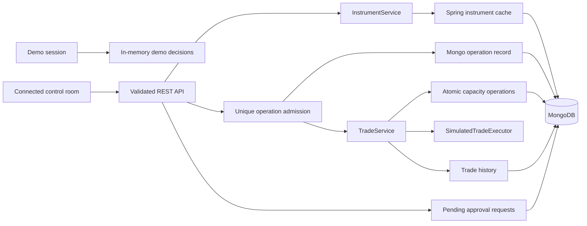

# Atlas architecture

This document describes the implemented request path. Atlas is a single Spring Boot service with a Streamlit client, not a collection of independently deployed microservices.

## Boundaries



The demo is session-local and uses no backend. Its data and decisions reset with the session or the reset button. Connected mode uses real API responses; it does not fall back to demo records when the API is unavailable.

## Decision sequence

1. Bean validation checks the nested instrument, counterparty, and positive decimal amount (26 integral and 8 fractional digits). Malformed JSON and invalid requests return `400` before trade code runs.
2. An atomic insert into `trade_operations` grants one owner for a key. The ID is a SHA-256 key hash; the fingerprint length-prefixes every mapped request attribute and the canonical decimal amount. Strict UTF-8 encoding rejects malformed Unicode before insertion, avoiding replacement-character collisions. A duplicate returns a cached final result or `202`, while different details return `409`.
3. InstrumentService queries the complete instrument definition, including department. Spring caching wraps this lookup.
4. LimitService identifies the canonical limit record for a counterparty and product group, sorted by `_id`. This ensures legacy duplicate snapshots do not become independent spendable pools.
5. MongoDB atomically evaluates `availableLimit >= amount` and applies a Decimal128 `$inc` debit to that record. The preceding read selects identity; only this conditional update grants capacity.
6. TradeService calls the simulated executor. Success consumes the reservation; definite failure credits it back atomically. Rejected, failed, and executed outcomes are saved to history using the operation ID as history ID. Only then is the final response stored on the operation.

The API returns `404` for an absent limit. An insufficient balance is a recorded `REJECTED` trade decision, not an execution attempt.

## Concurrency and failures

Single-document MongoDB updates serialize competing reservations. A regression test starts 32 concurrent requests for 75 against 1,000: exactly 13 reserve successfully and the remaining balance is 25. A second test verifies 64 concurrent releases retain all credits. These run against MongoDB, not a mocked repository.

The HTTP gate is tested with 32 concurrent requests using one key: one owner executes and debits, while the other 31 return pending without waiting for the owner. Completed duplicates replay the original result, including business failures. A key with `1.0` and `1.00` has the same fingerprint.

The operation state is `IN_PROGRESS` after admission and `COMPLETED` after the history and final result writes succeed. A caught runtime failure marks `RECONCILIATION_REQUIRED`; a process crash can leave `IN_PROGRESS`. Both pending states replay as `202 IN_PROGRESS` and never invoke execution automatically. There is no TTL or automatic takeover.

This is not a transaction spanning admission, capacity, execution, history, and final response. Important limits remain:

- A crash after reservation can leave capacity held. A durable operation snapshot helps manual reconciliation, but there is no recovery worker or complete reservation ledger.
- HTTP retries are protected only when clients preserve their original key and payload. Requests without a key remain independent; the returned operation hash cannot be substituted as a key.
- The guarantee depends on retaining the acknowledged Mongo operation record. Deleting or expiring it permits execution again. Keys are global because there is no authenticated principal yet.
- Direct low-level compensation assumes a caller releases once.
- An unknown executor outcome retains the reservation rather than assuming execution failed. No automatic reconciliation is implemented.
- A history write can fail after capacity or execution has changed. Those writes are not coordinated by a Mongo transaction.
- Decimal storage is exact within the declared range; FX conversion and currency-specific rounding are not modeled.
- The canonical-row rule assumes limit records are not deleted or replaced during an in-flight reservation. Administrative limit mutation requires a versioned identity design.

The simulated executor sleeps for 500 ms and selects success with probability 0.9. Unit tests inject an executor so both paths are deterministic. Cancellation returns failure and preserves the interruption signal; timings and probabilities are not performance results.

## Decimal storage and legacy balances

Trade requests, histories, snapshots, and limits use `BigDecimal` mapped to BSON Decimal128. Python uses `Decimal` and sends decimal strings; JSON responses decode without a binary float conversion. Trailing zeros do not affect validation or fingerprints. More than 26 integral or 8 fractional digits is rejected without rounding.

On limit access, a legacy double/integer/long is read from raw BSON and converted with a compare-and-set that matches both its value and BSON type. This prevents a racing migration from overwriting an already-decimal debit. Doubles use `BigDecimal.valueOf`, preserving the shortest round-trip decimal spelling, not reconstructing an intended pre-float value. `0.3` is supported; `0.30000000000000004`, NaN, infinity, negative balances, or unsupported encodings require explicit reconciliation. Historical records are read as decimals but are not rewritten by a bulk migration.

The backend tests cover exact `0.1`/`0.2` arithmetic, raw BSON Decimal128 storage, supported bounds, and migration concurrent with reservations. The client uses a larger local Decimal context for aggregation; only chart/progress rendering converts to approximate floats.

## Seed data

CSV rows are decoded as UTF-8. Natural-key lookups preserve existing legacy records. Fresh records receive deterministic string IDs and use `$setOnInsert`, preventing concurrent starts from multiplying a limit pool or overwriting its consumed balance. Repeated, concurrent, and legacy-data cases have integration tests.

Fixtures are loaded by default. `APP_SEED_DATA_ENABLED=false` disables the initializer. Seeding is not a migration system and does not delete old duplicate records or reconcile changed external limit snapshots.

## Supporting components

MongoDB holds instruments, limits, trade history, and pending approval requests. Caffeine is configured for local Spring caching. Redis configuration, a Redis circuit-breaker helper, and a Bloom-filter utility remain in the codebase, but the implemented trade decision path does not call those helpers. Redis is not an authority for available capacity, and the presence of these utilities does not establish a tested two-level cache.

The API currently permits unauthenticated requests. Approvals can be created as `PENDING`, but there are no reviewer roles or approve/reject actions. Security headers and CORS do not provide authentication.

## Running and checking

Compose runs MongoDB 7, Redis 7, the Java API, and Streamlit. The frontend waits for backend health. Java heap options precede `-jar`; both images run as non-root users and provide health probes available inside their images. Production logs use stdout unless `LOGGING_FILE_NAME` explicitly selects a writable file.

`application.yml` supplies shared defaults, and development/production YAML honors environment overrides. A duplicate properties file no longer silently forces a different profile.

CI runs Java tests, Python unit/Streamlit AppTest cases, Trivy reporting, Docker builds, and a full Compose health/API/UI smoke check. The legacy Checkstyle job remains advisory (`continue-on-error`); its green job status is not proof that every formatting rule passed.

Local checks:

```bash
mvn -B clean test
python3 -m unittest discover -s python_src -p 'test_*.py' -v
docker compose config --quiet
docker compose up --build --wait
```
