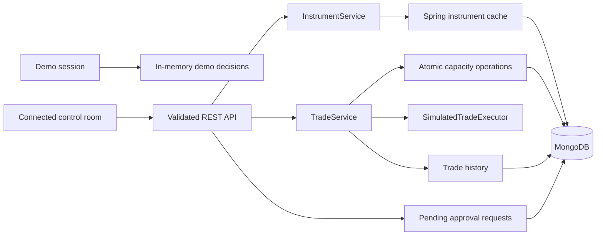

# Atlas architecture

This document describes the implemented request path. Atlas is a single Spring Boot service with a Streamlit client, not a collection of independently deployed microservices.

## Boundaries



The demo is session-local and uses no backend. Its data and decisions reset with the session or the reset button. Connected mode uses real API responses; it does not fall back to demo records when the API is unavailable.

## Decision sequence

1. Bean validation checks the nested instrument, counterparty, and finite positive amount. Malformed JSON and invalid requests return `400` before service code runs.
2. InstrumentService queries the complete instrument definition, including department. Spring caching wraps this lookup.
3. LimitService identifies the canonical limit record for a counterparty and product group, sorted by `_id`. This ensures legacy duplicate snapshots do not become independent spendable pools.
4. MongoDB atomically evaluates `availableLimit >= amount` and applies `$inc: -amount` to that record. The preceding read selects identity; only this conditional update grants capacity.
5. TradeService calls the simulated executor. A success consumes the reservation; a definite failure credits it back with atomic `$inc`. Rejected, failed, and executed service outcomes are saved to history.

The API returns `404` for an absent limit. An insufficient balance is a recorded `REJECTED` trade decision, not an execution attempt.

## Concurrency and failures

Single-document MongoDB updates serialize competing reservations. A regression test starts 32 concurrent requests for 75 against 1,000: exactly 13 reserve successfully and the remaining balance is 25. A second test verifies 64 concurrent releases retain all credits. These run against MongoDB, not a mocked repository.

This is not a transaction spanning capacity, execution, and history. Important limits remain:

- A crash after reservation can leave capacity held. There is no durable reservation ledger or recovery worker.
- Request retries are not idempotent; compensation assumes a caller releases once.
- An unknown executor outcome retains the reservation rather than assuming execution failed. No automatic reconciliation is implemented.
- A history write can fail after capacity or execution has changed. Those writes are not coordinated by a Mongo transaction.
- Amounts use `Double`; decimal precision, rounding, and currency conversion are not modeled.
- The canonical-row rule assumes limit records are not deleted or replaced during an in-flight reservation. Administrative limit mutation requires a versioned identity design.

The simulated executor sleeps for 500 ms and selects success with probability 0.9. Unit tests inject an executor so both paths are deterministic. Cancellation returns failure and preserves the interruption signal; timings and probabilities are not performance results.

## Seed data

CSV rows are decoded as UTF-8. Natural-key lookups preserve existing legacy records. Fresh records receive deterministic string IDs and use `$setOnInsert`, preventing concurrent starts from multiplying a limit pool or overwriting its consumed balance. Repeated, concurrent, and legacy-data cases have integration tests.

Fixtures are loaded by default. `APP_SEED_DATA_ENABLED=false` disables the initializer. Seeding is not a migration system and does not delete old duplicate records or reconcile changed external limit snapshots.

## Supporting components

MongoDB holds instruments, limits, trade history, and pending approval requests. Caffeine is configured for local Spring caching. Redis configuration, a Redis circuit-breaker helper, and a Bloom-filter utility remain in the codebase, but the implemented trade decision path does not call those helpers. Redis is not an authority for available capacity, and the presence of these utilities does not establish a tested two-level cache.

The API currently permits unauthenticated requests. Approvals can be created as `PENDING`, but there are no reviewer roles or approve/reject actions. Security headers and CORS do not provide authentication.

## Running and checking

Compose runs MongoDB 7, Redis 7, the Java API, and Streamlit. The frontend waits for backend health. Java heap options precede `-jar`; both images run as non-root users and provide health probes available inside their images. Production logs use stdout unless `LOGGING_FILE_NAME` explicitly selects a writable file.

`application.yml` supplies shared defaults, and development/production YAML honors environment overrides. A duplicate properties file no longer silently forces a different profile.

CI runs Java tests, Python unit/Streamlit AppTest cases, Trivy reporting, Docker builds, and a full Compose health/API/UI smoke check. The legacy Checkstyle job remains advisory (`continue-on-error`); its green job status is not proof that every formatting rule passed.

Local checks:

```bash
mvn -B clean test
python3 -m unittest discover -s python_src -p 'test_*.py' -v
docker compose config --quiet
docker compose up --build --wait
```
