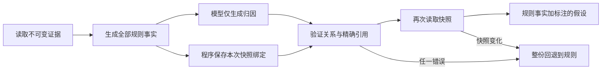

# Atlas v4：程序拥有事实，模型只写归因

2026-10-22（Asia/Singapore）。本轮完成协议改造、默认规则性能优化及离线验证，**新增真实模型请求 0 次，新增 API 费用 $0**。最近一次真实 Luna 测量仍是 [v3 的 20% 回退、14/17 参考关系覆盖](LUNA_EVALUATION.md)；不能用本轮离线迁移结果替换它。

后续更新（2026-10-23）：[单独的 v4 真实复测](ATTRIBUTION_V4_LIVE_EVALUATION.md)已完成，0/10 回退、17/17 关系覆盖，含评审费用 $0.039575。本文保留 10 月 22 日离线工作的历史口径；下文“尚未复测”均指该时点，条件性投影仍不是新实测。

## 把模型不该承担的责任移出输出

上一轮 Luna 的一份响应正确识别了三条关系，却漏掉必需的回执事实；另一份响应抄错了快照哈希。V4 的模型输出只有：

```json
{"attributions": []}
```

摘要、全部规则事实、检查项及其顺序都由服务器生成。模型不会接收或复制快照哈希，也不能选择省略事实。可信适配器在请求完成后附加本次分析的哈希和 `ATTRIBUTIONS_V4` 格式标记；这些是程序元数据，不属于模型 JSON。模型输出中出现 `snapshotHash`、`findingIds`、操作字段或自选格式字段，一律拒绝。

请求上下文和 JSON Schema 中的映射按键排序，并记录 `sorted-map-keys-v1`，排除字段插入顺序造成的无关输入差异。相同内容会产生相同请求正文字节；这不保证模型输出稳定，也不能消除评审的位置偏好。

旧的四／五字段计划仍由显式的 legacy 适配器严格校验，保留历史和测试兼容性。程序不会根据 JSON 的形状自动选择协议，也不会把错误旧响应偷偷修补后用于生产。新的空归因模式叫 `model_no_attribution`，明确表示没有额外归因。



错误时间方向、单事件冒充重复、过早恢复、重复关系和无关引用仍会拒绝整份归因。并发状态变化会丢弃全部旧叙述，且不会追加模型请求。新协议没有额度、审批、对账或交易执行能力。

## 离线迁移能说明什么

将三轮已有响应的 `attributions` 子树原样投影到 v4，由程序绑定相同快照并恢复规则事实。未改动任何归因、文字、引用或顺序，未调用模型。

| 保留响应来源 | 原计划接受数 | 条件性 v4 投影接受数 | 条件性投影参考关系覆盖 |
| --- | ---: | ---: | ---: |
| 首轮 v2 | 4/10 | 4/10 | 3/17 |
| 次轮 v3 | 2/10 | 2/10 | 1/17 |
| Luna v3 | 8/10 | 9/10 | 16/17 |

Luna 的回执事实遗漏不再导致整份丢弃。那个把 1 秒误判为达到 60 秒阈值的案例仍被拒绝，即使哈希复制任务已移出模型。**这不是新模型成绩，也不是实测 v4 的 10% 回退率或 16/17 质量结果**：模型尚未看到新提示词，实际输出可能改变。它只隔离了程序责任划分对已有响应的条件性影响。

[迁移回放完整记录](examples/ai-explanations/attribution-v4-offline/migration-replay.json) · [旧响应原协议回归](examples/ai-explanations/attribution-v4-offline/historical-replay.json)

V4 保留同样的原始时序、证据和通用关系定义，不把规则版计算出的可用关系或参考答案交给模型。十例上下文合计从 45,159 降到 40,619 UTF-8 字节，约减少 10.1%；字节减少不等于同样比例的 token、费用或延迟下降，后者尚未测量。

## 默认规则路径从枚举事件对改为线性候选发现

旧规则算法对每种关系枚举几乎所有 `(from,to)` 组合，大量依赖失败异常淘汰。新实现扫描首／末 UNKNOWN、最后状态和回执，构造不超过八个有类型的候选，再交给相同证明器，保留原优先级和最多三条输出。找到三条后停止。

时间逆序使用后缀最小时间找最早可能的起点，再找到最早对应终点。它保留旧枚举的引用选择，能够处理非相邻逆序，且不会误选后缀最小值所在的较晚事件。候选发现和常数次验证合计为 O(n)，旧枚举则需要 O(n²) 个候选尝试，并在每次验证中重新扫描事件。

在 64 条事件、没有回执的单一本地样例上：

| 纯规则选择器 | 中位耗时 |
| --- | ---: |
| 旧事件对枚举 | 323.130 ms |
| 新线性候选选择 | 0.092 ms |

同一当前证明／渲染内核，先校验输出相等，再各预热三次、各测量十一次；旧算法额外有一次建立期望结果的未计时调用，已记录。顺序固定为旧后新。环境为 Mac OS X / aarch64、Java 17.0.14，使用现有 Maven 覆盖率代理。没有数据库、HTTP 或模型调用；这不是生产负载、端到端延迟或产品加速倍数承诺。

[全部原始计时及环境](examples/ai-explanations/attribution-v4-offline/selector-benchmark.json)

## 新增边界和数值精度检查

固定种子 `20261022` 生成 64 组开发场景，并比较原 12 例：59,999／60,000／60,001 ms 阈值、回执先／同／后、事件时间相等、首末 UNKNOWN、两种终态、非相邻时钟逆序和 64 条事件上限。线性算法与旧枚举在同一当前内核下返回相同关系、引用顺序及叙述。它们共享证明器，因此这不是独立的语义正确率证明；阈值与精度另有直接断言。

- 恰好 60 秒的说明现在写“达到阈值”，而不是“高于阈值”。
- 亚毫秒关系按精确秒值渲染，1 ns 不会被显示为“0 秒之前”。提示明确区分毫秒偏移与精确时间戳。
- 超出 long 毫秒可表示范围的事件／回执跨度，在生成规则或调用模型前弃答，避免时间运算溢出。
- v4 检查跨交易绑定、生成期间状态变化、重复／多余引用、错误类型、过长／活动文字及操作字段；真实 Mongo 测试验证这些路径不改变交易、额度、审计或回执。

[64 组完整输入及候选等价性](examples/ai-explanations/attribution-v4-offline/boundaries.json)

## 报告口径与验证

接受的空归因单独计数，不能仅凭零回退声称有用。传统评测报告的“相同展示”现在包含归因文本的比较；规则文字保留指标只描述规则事实和检查项。它不再用“全部文字经过审核”这类可能覆盖自由叙述的名称。引用完整性表示证据身份成立，不能证明文字蕴含或根因。

完整离线 `verify` 通过，随后新增加的解析变异断言、请求正文稳定性和基准元数据通过定向复核；四项 Python 报告测试通过。原三轮全部 30 条生成响应和 6 个弃答对照，仍保留原协议的接受／拒绝和历史叙述。[验证记录](examples/ai-explanations/attribution-v4-offline/local-validation.json)区分完整验证与后续定向运行。五种打包后端 HTTP 演示也已通过，解释和拒绝 POST 前后的业务文档哈希一致，真实模型请求为零，子进程退出已确认。见 [HTTP 验证](examples/ai-explanations/attribution-v4-offline/http-demo.json)；最终远端状态在交付记录补充。

复现（不加载私有 key、不调用真实模型）：

```sh
mvn -o test -Dtest=AttributionReplyTest,AttributionMigrationReplayTest,CrossEventBoundaryTest,CrossEventReplayTest
mvn -o test -Dtest=CrossEventRuleBenchmarkTest -Datlas.explanation.rules-benchmark=true
python3 -m unittest discover -s scripts/tests
```

真实模型评测继续是显式付费入口，保留最多 30 次请求和默认 $0.10 运行预算；本轮未启用。下次应冻结 v4 提示、继续使用同一模型和案例、固定评审，并同时报告解释质量与协议通过率；不能把本轮条件性回放冒充真实调用。

官方 [Structured Outputs 文档](https://developers.openai.com/api/docs/guides/structured-outputs)用于核对 required、枚举、maxItems 和 additionalProperties 等形状约束；证据和业务判断仍由本地程序验证。默认 UI 继续使用零模型的强化规则，AI 保留实验入口及明确的语义局限。
