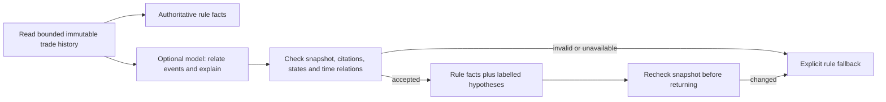

# Cross-event explanation and comparison

Atlas keeps the recorded decision, money/state invariants and reviewed rule findings authoritative. The optional model now connects events and authors short interpretations, rather than only ordering existing finding IDs. It has no tools or business mutation dependencies.

## Observations and hypotheses

Each additional attribution contains `relation`, program-computed `observedRelation` (with checked durations/state), model-authored `interpretation` and `uncertainty`, exact `evidenceIds`, and a `validationScope` that explicitly says temporal/state verification is not semantic verification of prose or proof of physical causation.

The API summary, required findings and inspection checks still come from rules. A matching execution receipt cannot turn current UNKNOWN into EXECUTED through this endpoint. The UI displays the checked observation separately from the AI hypothesis, uncertainty and evidence references. Model strings display as plain text, with no operation controls.



## Relationship checks

| Relation | Required evidence and meaning |
| --- | --- |
| `RECEIPT_BEFORE_UNKNOWN` | Matching receipt strictly before the first UNKNOWN; consistent with acknowledgement/local-commit gap, not proof of either |
| `RECEIPT_AFTER_UNKNOWN` | First UNKNOWN strictly before receipt creation; creation time is not a proven execution/arrival time |
| `REPEATED_UNKNOWN` | First and last distinct UNKNOWN; repeated observations do not count venue submissions |
| `RECOVERY_COMPLETED` | First UNKNOWN, latest terminal event and matching receipt; final recorded state resolves historical uncertainty |
| `DISPATCH_DELAY` | Initial RESERVED to SUBMITTED interval at least 60 seconds; inspection threshold, not trading rule or SLA |
| `SETTLEMENT_GAP` | Receipt to latest UNKNOWN/terminal event at least 60 seconds; historical interval, not current wall-clock age |
| `TEMPORAL_ORDER_UNRELIABLE` | Increasing event sequence with decreasing timestamps; physical elapsed-time diagnosis is unreliable |
| `NO_RECEIPT_NOT_FAILURE` | Latest UNKNOWN plus absent-receipt query; neither rejection nor no execution is established |

The generator receives typed records, existing rule facts and generic relation definitions. It is not given applicable relations, precomputed diagnoses, reference goals or benchmark answers. It chooses operands and writes the interpretation. The verifier independently checks operand identities, exact relevant citation sets, predicate preconditions and snapshot binding, then computes the observation itself. If any event timestamps reverse, duration/receipt-order attributions are rejected; the explicit time-order warning and bounded no-receipt statement remain available.

The v3 input uses short aliases (`E0`, `E1`, `R`, `Q`) and numeric recorded-time offsets relative to the first event. The response schema restricts operands to actual aliases. The server resolves them into full source references within the bound snapshot before checking proofs. This reduces long-ID transcription and timestamp parsing errors without preselecting applicable relations or changing the source records. Original v2 raw-reference inputs and failed results are retained for comparison.

There are at most three attributions, each relation at most once. Each cites two exact relevant records; terminal recovery additionally cites the matching receipt. Extra action fields, invented/unrelated citations, false time direction, missing receipt, premature settlement, duplicate relations, active markup/URLs and oversized text are rejected. Invalid output falls back atomically. A stale snapshot discards the entire narrative without a second request.

This verifies the observed relation, not entailment or calibration of every model-authored sentence. Fluent text can still overclaim; semantic error flags are evaluated separately. No “all AI statements are verified” claim is made. Root-cause certainty needs more than temporal order. API authentication, process isolation and database roles remain separate production concerns.

## Three-way evaluation

`evals/explanations/cross-event-cases.json` freezes twelve synthetic, development-visible cases before the v2 provider run. Ten cover receipt order, repeated uncertainty, eventual execution/rejection, dispatch delay, unsettled old receipt, rapid settlement, timestamp disagreement and sparse evidence. Two invalid-evidence controls must abstain without provider access. Reference goals are withheld from generation. This is not a heldout or production dataset.

All variants use the same snapshot:

1. Original rules: existing summary, findings, history and read-only checks, with timestamp evidence available.
2. Stronger cross-event rules: deterministic enumeration using the same proof checker, up to three observations and carefully written interpretations/uncertainties. This tests whether the improvement can be achieved without a model.
3. AI: original rule facts plus accepted generated attributions. Actual fallback output stays in the denominator.

Mechanical metrics count accepted proofs, predeclared relation coverage, unchanged authoritative summary, fallback and abstention. Explicit relation recall is not prose comprehension accuracy: original rules can express useful meaning without proof objects. The stronger comparator prevents presenting new temporal calculations as uniquely AI-powered reasoning.

A separate reviewer request sees reference evidence/goals and source-concealed A/B/C presentations. It scores fully covered goals, unsupported statements, citation errors, unsafe operation advice, clarity and uncertainty calibration, then compares AB/AC/BC. Labels are shuffled with a declared seed; a second request reverses positions. The source mapping is retained in artifacts but never sent to the reviewer. Only preferences agreeing in both orientations count as stable wins/losses/ties. Disagreement and missing reviews remain separate outcomes. Each case counts once; repeated presentations are not independent samples.

Reviewer contract v2 uses fixed AB/AC/BC object keys with pair-specific winner enums, preventing omitted/duplicated pairs or an unrelated winner. Retained legacy unordered pairs can normalize orientation without changing their winner, but missing/duplicate pairs still fail validation. The [official evaluation guidance](https://developers.openai.com/api/docs/guides/evaluation-best-practices) motivates task-specific criteria and pairwise comparisons; [Structured Outputs](https://developers.openai.com/api/docs/guides/structured-outputs) constrains shape, not factual truth.

The configured snapshot generates and reviews, so self-preference/correlated errors remain possible. These are provisional model judgements, not human truth. Human review remains null. Raw inputs/outputs, failures, flags and disagreements are retained; no failed case is dropped or retried. Report gains against both baselines and semantic error flags alongside preference.

## Run and replay

Use the private ignored `.env.local` in [AI_EXPLANATIONS.md](AI_EXPLANATIONS.md). Preserve the selected available model; the initial comparison uses `gpt-4.1-mini-2025-04-14`.

```sh
# No model calls:
mvn test -Dtest=CrossEventVerifierTest,CrossEventJudgeTest,ExplanationModelReportTest
python3 -m unittest discover -s scripts/tests
python3 scripts/run-cross-event-eval.py --check-config

# Explicitly paid: <=10 generation + 20 reviewer requests; no retries/warmups.
python3 scripts/run-cross-event-eval.py --limit 10

# Standalone read-only replay, no API/database access:
python3 scripts/build-cross-event-demo.py \
  --results target/cross-event-evaluations/<run>/results.json \
  --output target/cross-event-demo.html
```

Every round creates a fresh directory with checkpointed raw results, aggregated summary, readable report, manifest and sanitized log. Checkpoints retain observed usage after each response; interrupted in-flight billing may be unknown. Generation/reviewer costs are separate and summed. Missing usage/prices never become zero total cost. Requests use the official Responses endpoint, standard tier, `store:false`, no tools/redirects/application retries, 8-second overall deadline, at most two in-flight calls per client, 32 KiB request and 64 KiB retained response bounds. V2 allows 1,400 output tokens; v1 artifacts retain their original 512-token settings.

Ordinary CI skips both paid suites. It runs proof/transport/reviewer-contract tests, real Mongo non-mutation checks, Python aggregation tests and the packaged-JVM HTTP demo. The frozen-snapshot benchmark does not establish live HTTP throughput or production semantic quality. Consult the retained comparison report for actual measurements; this specification does not assert a measured improvement.
